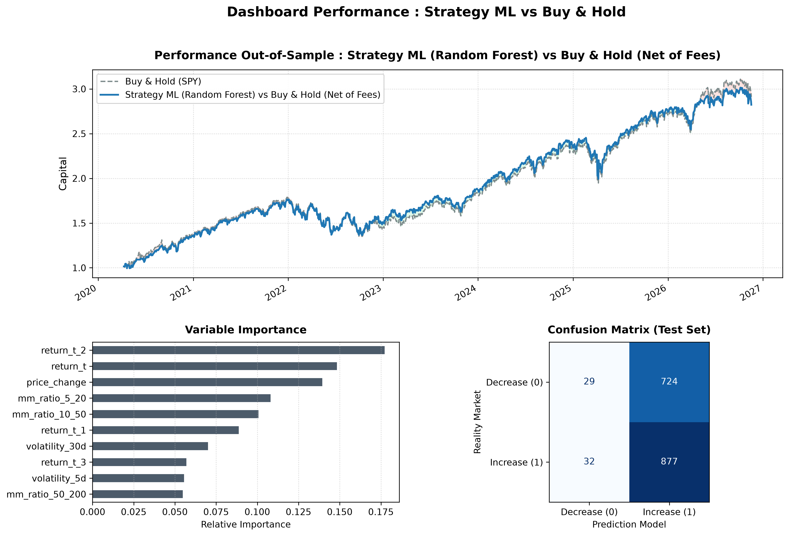
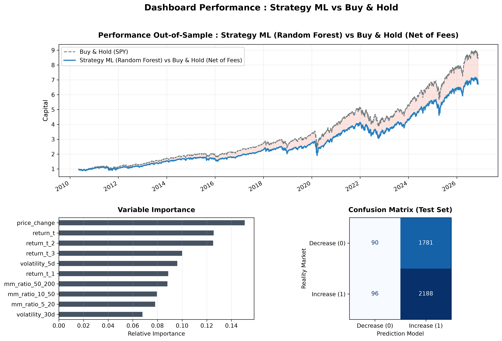
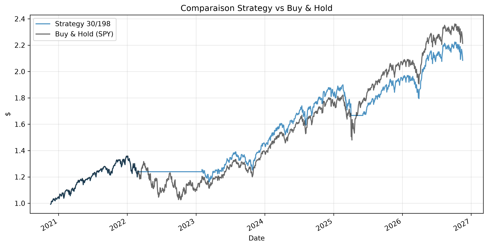

# Quantitative Trading Strategy: SPY Directional Prediction with Random Forest

## Project Overview
This project implements two end-to-end machine learning pipelines to predict next-day directional movements of the **S&P 500 ETF (SPY)**. The framework enforces chronological integrity to eliminate look-ahead bias and evaluates strategy viability net of transaction costs.
A Crossover Moving Average Strategy is also part of the tests, no ML for this one. It's less important but I still decided to keep it because it's what actually made me realized this project in ML.

---

## Performance Summary



### Risk-Adjusted Metrics Comparison on the same period (2020 - 2026)
| Metric | Buy & Hold (SPY) | ML Strategy (Net of Fees) |
| :--- | :---: | :---: |
| **Annualized Return** | 17.60% | **17.05%** |
| **Annualized Volatility** | 17.11% | **16.61%** |
| **Sharpe Ratio** | 0.92 | **0.91** |
| **Maximum Drawdown** | -24.50% | **-22.63%** |



### Risk-Adjusted Metrics Comparison (2010 - 2026)
| Metric | Buy & Hold (SPY) | ML Strategy (Net of Fees) |
| :--- | :---: | :---: |
| **Annualized Return** | 13.80% | **12.04%** |
| **Annualized Volatility** | 17.06% | **16.64%** |
| **Sharpe Ratio** | 0.73 | **0.65** |
| **Maximum Drawdown** | -33.72% | **-33.72%** |



### Risk-Adjusted Metrics Comparison (2020 - 2026)
| Metric | Buy & Hold (SPY) | MM 30 / MM 198 Strategy (Net of Fees) |
| :--- | :---: | :---: |
| **Annualized Return** | 13.81% | **11.49%** |
| **Annualized Volatility** | 20.12% | **11.41%** |
| **Sharpe Ratio** | 0.65 | **0.84** |
| **Maximum Drawdown** | -33.72% | **-14.43%** |

*(Note: Strategies returns incorporate a 10 bps transaction cost penalty per trade)*

---

## Methodology & Rigor ML Strategies

1. **Features**
   * Raw non-stationary price series are transformed into stationary momentum, trend, and volatility indicators:
     * **Lagged Returns:** t, t-1, t-2, t-3 daily returns.
     * **Moving Average Ratios:** Short-to-medium and medium-to-long trend crossovers (`10/50`, `50/200`, `5/20`).
     * **Volatility:** Annualized 5-day and 30-day rolling standard deviations.
     * **Medium-Term Momentum** 20-day rate of change.

2. **Target Alignment & Look-Ahead Bias Prevention**
   * Targets are explicitly shifted (`shift(-1)`) so that features observed at market close t predict the return direction at t+1.
   * Trading signals are lagged by one period (`shift(1)`) during backtesting to ensure positions are only entered after signal generation.
   * Feature scaling (`StandardScaler`) is fit on training folds before transforming out-of-sample data.

3. **Hyperparameter Optimization & Validation**
   * Regularized `RandomForestClassifier` (`max_depth`, `min_samples_leaf`, `n_estimators`) via `GridSearchCV` for **`TimeSeriesSplit`**.
   * Evaluated using **`TimeSeriesSplit`** and **`Walk-Forward`** validation.

---

## Limitations

**ML Models**: due to the S&P 500's long-term upward drift, the classifier exhibits a strong bias toward predicting upward days (`1`). The 10 bps transaction fees erode any marginal alpha, causing the strategy to underperform Buy & Hold.

**Moving Average Strategy**: acts as an effective defensive filter, reducing both volatility and maximum drawdown. But it underperforms the S&P 500 on an annualized return basis probably due to lagging signals during market recoveries.

## Repository Structure

```text
├── data/                   # Local CSV market data cache (ignored by Git)
├── Graphics/               # Exported high-resolution performance dashboards
│   └── strategy_mm_graph.png
│   └── time_series_graph.png
│   └── walk_forward_graph.png
├── backtest_functions.py   # Risk metrics (Sharpe, Drawdown)
├── walk_forward.py         # ML training, Walk Forward
├── time_series.py         # ML training, Time Series strategy
├── strategy_mm.py          # Moving Average crossover strategy
├── requirements.txt        # Pinned Python dependencies for reproducibility
└── README.md


